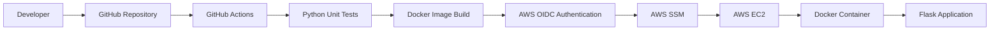

# AWS DevOps CI/CD Pipeline Using GitHub Actions, Docker and AWS EC2

## Project Overview

This project demonstrates an automated CI/CD pipeline that builds, tests, containerizes, and deploys a Python Flask application to an AWS EC2 instance.

It uses GitHub Actions for automation, Docker for containerization, AWS IAM OIDC for secure authentication, and AWS Systems Manager (SSM) to deploy the application without storing long-lived AWS access keys in GitHub.


## Architecture


## Architecture

The CI/CD pipeline starts when a developer pushes code to GitHub. GitHub Actions runs Python tests and builds a Docker image. AWS OIDC provides secure authentication, and AWS SSM deploys the application to EC2.




## Technologies Used

- Python 3.12
- Flask
- Git and GitHub
- GitHub Actions
- Docker
- AWS EC2
- AWS IAM and OIDC
- AWS Systems Manager (SSM)
- Linux (Amazon Linux 2023)

## Project Features

- Automated testing using GitHub Actions.
- Automated Docker image build.
- Secure AWS authentication using OIDC.
- EC2 deployment through AWS Systems Manager.
- Docker container execution on EC2.
- Application health-check endpoint.
- Automated deployment after code is pushed to the main branch.

## CI/CD Workflow

1. Developer pushes code to the GitHub repository.
2. GitHub Actions workflow is triggered.
3. Python dependencies are installed.
4. Automated unit tests are executed.
5. Docker image is built.
6. GitHub Actions authenticates with AWS using OIDC.
7. AWS Systems Manager sends deployment commands to EC2.
8. The application is built and started inside a Docker container.
9. The application health endpoint is checked.

## AWS Configuration

- EC2: Amazon Linux 2023
- Instance type: t3.micro
- Region: ap-south-1 (Mumbai)
- Deployment: AWS Systems Manager
- Authentication: IAM Role with GitHub OIDC
- Container port: 5000
- Public application port: 80

## Application Endpoints

- Home page: `http://EC2-PUBLIC-IP/`
- Health check: `http://EC2-PUBLIC-IP/health`

The health endpoint returns:

```json
{
  "status": "healthy"
}
```

## Repository Structure

aws-devops-cicd-project/
│
├── .github/
│   └── workflows/
│       └── ci.yml
│
├── tests/
│   └── test_app.py
│
├── .dockerignore
├── Dockerfile
├── README.md
├── app.py
└── requirements.txt

## Description
| File / Folder | Description |
|---|---|
| `.github/workflows/` | GitHub Actions CI/CD workflow |
| `tests/` | Python unit tests |
| `app.py` | Flask application |
| `Dockerfile` | Docker image configuration |
| `.dockerignore` | Excludes unnecessary files |
| `requirements.txt` | Python dependencies |
| `README.md` | Project documentation |

## How to Run Locally

```bash
python -m venv .venv
```

Windows PowerShell:

```powershell
.venv\Scripts\Activate.ps1
```

Install dependencies:

```bash
pip install -r requirements.txt
```

Run tests:

```bash
python -m unittest discover -s tests -v
```

Start application:

```bash
python app.py
```

## Docker Commands

Build image:

```bash
docker build -t aws-devops-cicd-app .
```

Run container:

```bash
docker run -d --name aws-devops-cicd-container -p 5000:5000 aws-devops-cicd-app
```

Open:

`http://localhost:5000`

## Security Practices

- Used AWS IAM OIDC instead of long-lived AWS access keys.
- Restricted IAM role trust to the intended GitHub repository and main branch.
- Used IAM permissions for deployment through SSM.
- Avoided committing credentials and private keys to GitHub.
- Restricted EC2 inbound access according to application requirements.

## Project Status

Successfully tested and deployed.

- GitHub Actions CI: Passed
- Python unit tests: Passed
- Docker image build: Passed
- AWS OIDC authentication: Passed
- AWS SSM deployment: Passed
- EC2 application health check: Passed

## Resume Description

Built an automated AWS DevOps CI/CD pipeline using GitHub Actions, Docker, Python Flask, AWS EC2, IAM OIDC, and Systems Manager. Implemented automated testing, container image builds, secure cloud authentication, and deployment to an EC2 instance.

## Future Improvements

- Push Docker images to Amazon ECR.
- Add monitoring using Amazon CloudWatch.
- Configure HTTPS with a domain and TLS certificate.
- Add automated integration tests.
- Implement deployment rollback.

## Author

Harshal Bagul

GitHub: https://github.com/harshalbagul0987-ux
